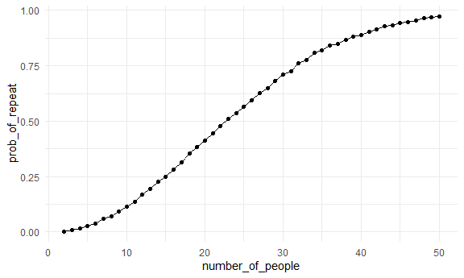
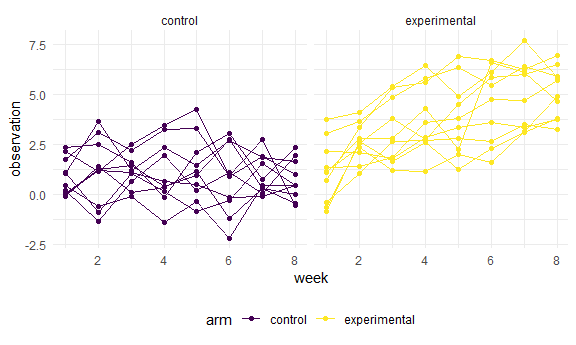
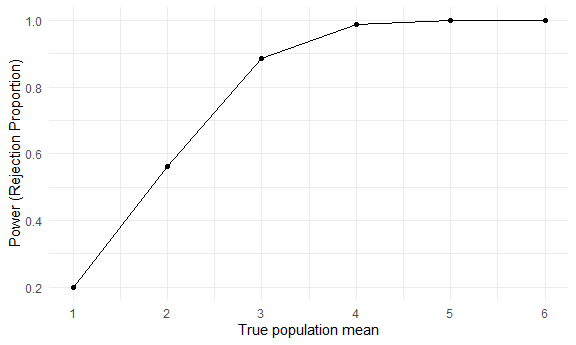
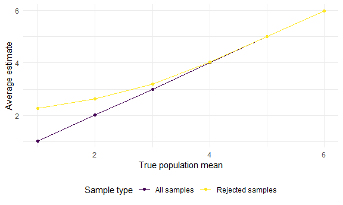

Homework 5
================
Helen Peng / hwp2110

# Problem 1

``` r
source("source/birthday_repeated.R")
group_sizes = 2:50

birthday_results_df = 
  expand_grid(
    number_of_people = 2:50,
    iter = 1:10000
  ) |> 
  mutate(
    repeated = map_lgl(number_of_people, birthday_repeated)
  )

birthday_results_df |> 
  group_by(number_of_people) |> 
  summarize(
    prob_of_repeat = mean(repeated) 
  ) |> 
  ggplot(aes(x = number_of_people, y = prob_of_repeat)) +
  geom_point() +
  geom_line()
```


From the plot, we obviously see that the probability of at least two
people sharing a birthday increases as the number of people in the group
increases. We see that the probability increases slowly for smaller
group sizes but rises more rapidly as the group size approaches around
20. At approximately 23 people, the probability exceeds 50%, meaning it
is more likely than not that at least two people share a birthday. By 50
people, the probability is approximately 97%.

# Problem 2

``` r
data_files = list.files("data", full.names = TRUE)

tidy_df = tibble(
  files = data_files
) |> 
  mutate(
    data = map(files, read_csv),
    file_name = str_remove(files, "data/"),
    arm = case_when(
      str_detect(file_name, "^con") ~ "control",
      str_detect(file_name, "^exp") ~ "experimental"
    ),
    subj = str_extract(file_name, "\\d+")
  ) |> 
  select(arm, subj, data) |> 
  unnest(data) |> 
  pivot_longer(
    week_1:week_8,
    names_to = "week",
    values_to = "observation",
    names_prefix = "week_"
  ) |> 
  mutate(
    week = as.numeric(week),
    subj = as.numeric(subj)
  )
```

``` r
tidy_df |> 
  ggplot(aes(x = week, y = observation, group = subj, color = arm)) +
  geom_point() + 
  geom_line() + 
  facet_grid(~arm)
```



The spaghetti plot shows the individual trajectories of participants in
the control and experimental arms over the 8-week study period. The
control group appears to remain relatively stable over time, with
observations fluctuating around lower values. In contrast, the
experimental group shows a clear increasing trend in observations over
time.

# Problem 3

``` r
source("source/sim_t_test.R")

output = vector("list", length = 5000)

for (i in 1:5000){
  output[[i]] = sim_t_test(n_obs = 30, sigma = 5, mu = 0)
}

output = output |> 
  bind_rows() 

head(output) # Showing only the first six observations to save space in the knitted document.
```

    ## # A tibble: 6 × 4
    ##   observation estimate p_value rejected
    ##         <dbl>    <dbl>   <dbl> <lgl>   
    ## 1      -2.15    -0.443   0.658 FALSE   
    ## 2      -0.709   -0.443   0.658 FALSE   
    ## 3       0.727   -0.443   0.658 FALSE   
    ## 4       5.60    -0.443   0.658 FALSE   
    ## 5       2.39    -0.443   0.658 FALSE   
    ## 6       3.30    -0.443   0.658 FALSE

``` r
mu_values = c(1, 2, 3, 4, 5, 6)

results_df = 
  expand_grid(
    mu_values = 1:6,
    iter = 1:5000
  ) |> 
  mutate(
    results = map(mu_values, 
                  \(mu) {sim_t_test(n_obs = 30, sigma = 5, mu = mu)})
  ) |> 
  unnest(results)
```

``` r
results_df |> 
  group_by(mu_values) |> 
  summarize(
    prop_rejected = mean(rejected)
  ) |> 
  ggplot(aes(x = mu_values, y = prop_rejected)) +
  geom_point() +
  geom_line() + 
  scale_x_continuous(breaks = 1:6) + 
  labs(
    x = "True population mean",
    y = "Power (Rejection Proportion)"
  )
```



There is a positive association between effect size and power. As the
true population mean moves farther away from the null value of 0, power
increases. In this simulation, power rises from about 20% when the true
mean is 1 to nearly 100% when the true mean is 4, and reaches 100% for
means of 5 and 6. This suggests that larger effect sizes are easier for
the test to detect, making it more likely to reject the null hypothesis.

``` r
results_df |> 
  group_by(mu_values) |> 
  summarize(
    avg_estimate = mean(estimate),
    avg_estimate_rejected = mean(estimate[rejected])
  ) |> 
ggplot(aes(x = mu_values)) +
  geom_line(aes(y = avg_estimate, color = "All samples")) +
  geom_point(aes(y = avg_estimate, color = "All samples")) +
  geom_line(aes(y = avg_estimate_rejected, color = "Rejected samples")) +
  geom_point(aes(y = avg_estimate_rejected, color = "Rejected samples")) +
  labs(
    x = "True population mean",
    y = "Average estimate",
    color = "Sample type"
  )
```



From the graph, we can see that the average estimate among samples where
the null hypothesis was rejected is larger than the average estimate
across all samples, especially when the true population mean is small.
This is because only looking at significant results tends to select
samples with larger estimates. As the true mean increases, the two
averages get closer together because more samples reject the null
hypothesis.
